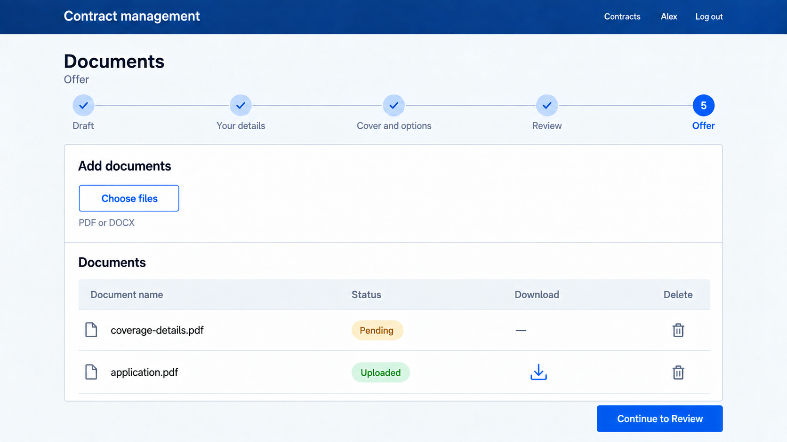

# 9. Document upload

## Read

- [RxJS overview](https://rxjs.dev/guide/overview)
- [forkJoin](https://rxjs.dev/api/index/function/forkJoin)
- [concatMap](https://rxjs.dev/api/operators/concatMap)
- [switchMap](https://rxjs.dev/api/operators/switchMap)
- [catchError](https://rxjs.dev/api/operators/catchError)

## Practice

Implement on the Offer step:

| What | Business description |
|------|----------------------|
| Service calls | Upload a document to a contract and download a document. The BFF accepts one file per upload request |
| File selection directive | A reusable directive for a file input that reports the chosen file and clears the input |
| Choosing files | A file picker that accepts only pdf and docx. A chosen file is **not** sent to the BFF until Save or Continue is pressed; it is kept in browser memory in a signal. Documents can only be added while the contract is in Offer |
| Documents table | Shows both files in memory and documents already stored in the BFF in one table. Each row has the document name, a status (`Pending` for files in memory or `Uploaded` for stored documents), a download icon and a delete icon. The download icon is enabled only for uploaded documents; deleting a pending document removes it from memory. Files in memory are lost when the page is reloaded |
| Save button | Uploads every pending file now, while keeping the contract in Offer. Enable it when at least one file is pending. After each successful upload, remove that file from memory and show it as `Uploaded` in the table. This lets the user save documents before moving to Review |
| Continue button | Disabled until the stored documents plus the files in memory are at least 2. Pressing it uploads any remaining pending files, then moves the contract to Review |
| Visibility | The file picker, Save and Continue buttons only exist while the contract is in Offer; the documents table stays visible afterwards. The pending-document delete action only exists while the contract is in Offer |
| Translations | All new texts in English and German |

The Save and Continue flows, managed with RxJS:

| Step | Business description |
|------|----------------------|
| 1 | Save sends one upload request for every file in memory and waits for all responses (see `forkJoin`, or `concatMap` to send them one after another). It never calls the transition endpoint |
| 2 | Continue first uploads any files still in memory and waits for **all** uploads to finish |
| 3 | Only then does Continue call the transition endpoint with the target stage Review. Chain it after the uploads (see `switchMap`) so it never starts earlier |
| 4 | After Save succeeds, show the uploaded documents in the table and keep the contract in Offer. After Continue succeeds, show the contract returned by the transition; its status is Review, so the stepper moves to the review step. The final signing is the next chapter |
| Failure | If an upload fails, show the BFF message (see `catchError`). Continue must not call the transition. Files that were already uploaded are removed from memory so a retry does not upload them twice; the failed ones stay |
| While running | Disable Save, Continue and the file picker so either flow cannot be started twice |
| Nothing to upload | When all documents are already stored and nothing is in memory, Continue only calls the transition |

Choose two files, remove one and add another, then press Save. Watch the network tab: one upload request per pending file and no transition request. Add another file and press Continue: it uploads that file and transitions only after the upload finishes.

## Visual mockup

## Tests

- The service uploads a file as a multipart form
- The directive reports the chosen file
- A chosen file is kept in memory and no request is sent
- A pending file can be deleted from the documents table
- An uploaded document can be downloaded using its download icon
- Save uploads pending files without changing the contract status from Offer
- After Save, uploaded files appear as `Uploaded` and are removed from memory
- Continue is disabled with one document in total, enabled with two
- Continuing sends one upload request per file and sends the Review transition only after all uploads have been answered
- If an upload fails, no transition request is sent and the message is shown; a retry does not reupload successful files
- After a successful flow the memory list is empty

Done when Save uploads local documents without leaving Offer, Continue uploads any remaining files before moving the contract to Review, and the tests are green.

## What to explain

- RxJs operator orchestration
